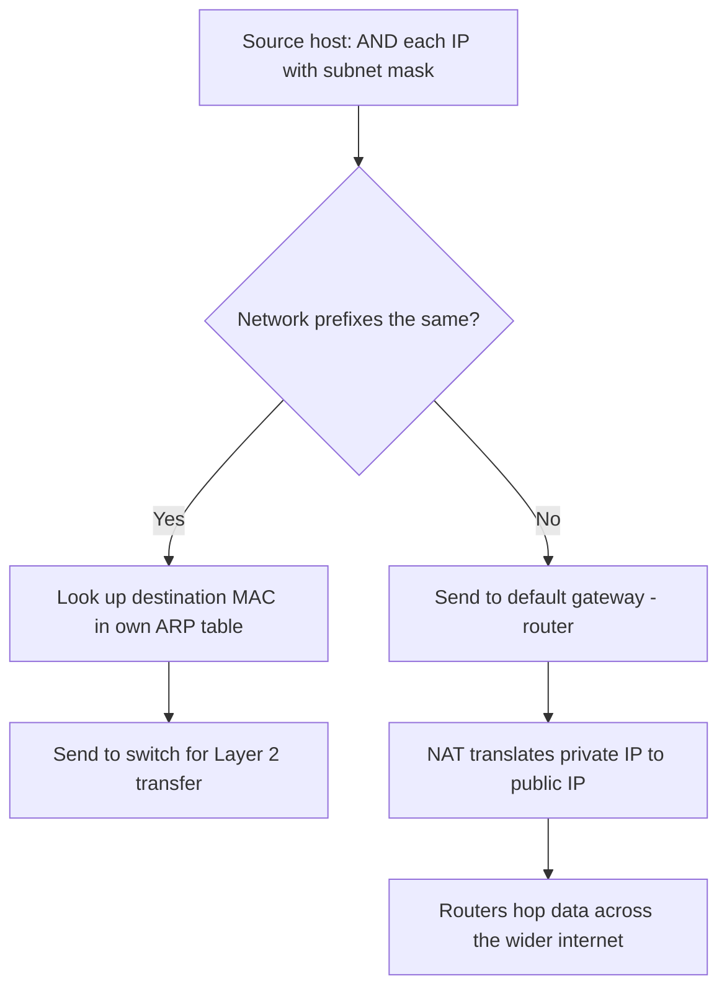

# 🌐 The OSI Model

> [!abstract] Summary
> The OSI model splits network communication into **7 layers**. Layers 1–3 are mostly handled by network hardware (NICs, switches, routers); layers 4–7 are handled by software on the host. Each layer prepares data for the layer below, wrapping it in extra header/footer information (**encapsulation**) until it becomes a bit stream on the transmission media.

> [!note] It's only a model
> This is just a model that structures an otherwise complex process. In reality, each individual protocol is responsible for preparing the data.

## Contents

- [[#Model overview|Model overview]]
- [[#Layer 1 - Physical|Layer 1 - Physical]]
- [[#Layer 2 - Data Link|Layer 2 - Data Link]]
- [[#Layer 3 - Network|Layer 3 - Network]]
- [[#Encapsulation|Encapsulation]]

---

## Model overview

| OSI Model Layer    | TCP/IP Model Layer       | Example Protocols                              |
| ------------------ | ------------------------ | ---------------------------------------------- |
| **7** - Application  | Application *(layers 5-7)* | DNS, DHCP, SMTP, POP3, IMAP, FTP, HTTP/S, REST |
| **6** - Presentation | ↑ *included above*       |                                                |
| **5** - Session      | ↑ *included above*       |                                                |
| **4** - Transport    | Transport                | TCP, UDP                                       |
| **3** - Network      | Internet                 | IPv4/v6, NAT, ICMP, EGP, EIGRP, OSPF           |
| **2** - Data Link    | Network *(layers 1-2)*   | ARP, Ethernet, WLAN                            |
| **1** - Physical     | ↑ *included above*       |                                                |

> [!info] Hardware vs software
> Layers 1-3 are completed by hardware components within the network, such as the **NIC** in the host, **routers** and **switches**.

---

# Layer 1 - Physical

- Includes hardware components such as **NICs** (wired/wireless)
  - A device may have multiple NICs.
- The **media**, such as copper, fibre or wireless.
- Layer 1 protocols convert stored data into a **stream of signals** that can be transmitted across the chosen media.

---

# Layer 2 - Data Link

> [!summary]
> The data link layer handles all communication **across a LAN**. It cannot route packets across networks the host is not directly connected to.

## Switches

- Forward data from one device to another **on the same network**.

| Type            | Typical size    | Management                       |
| --------------- | --------------- | -------------------------------- |
| Small desktop   | 4-6 devices     | Unmanaged                        |
| Enterprise      | 24-48 devices   | Managed, configured remotely     |

- Enterprise switches have an OS but no I/O, hence the need for remote access from another computer.
- Modern switches may embed firewalling and even some routing capabilities.

### How a switch learns

- When a switch receives data from a host for the first time, it records the **MAC address** and the **physical port** the data arrived on.
- MAC entries are typically held for **300 seconds**, and are refreshed whenever a packet from that address is received again.

## Sending local data

Assuming the devices are physically connected on the same network:

1. The data is sent from the originating host to the network's switch.
2. The switch recognises the destination host's MAC address from its MAC address table.
3. The switch forwards the data to the destination host.

> [!warning] No IP addressing here
> This process does **not** use IP addressing!

## MAC addresses

- At layer 2 we use MAC addresses, which are baked into the hardware NIC of a host.
- The 48-bit code is typically written as **6 pairs of hex values**:

  `00-1A-2B-3C-4D-5E`

  | Part        | Pairs | Meaning                       |
  | ----------- | ----- | ----------------------------- |
  | First half  | 3     | Manufacturer ID (OUI)         |
  | Second half | 3     | Unique device identifier      |

- MAC addresses are sometimes colloquially called "physical IDs" because they are baked into hardware and are effectively fixed.
- They should only be used by devices **on the same network**.

> [!example]- Cisco manufacturer IDs
> Cisco uses `00:00:0C`, `00:01:42`, or `00:1E:13` as manufacturer IDs.

## Error checking

> [!todo] To be completed
> TBC

---

# Layer 3 - Network

- **Supersedes MAC (physical) addressing** by using IPv4/v6 to address logically.
- Provides **pathfinding** for the best routing of data to remote networks, anywhere in the world.

## Routers

- A router has **at least two physical NICs**, so it can belong to two networks and bridge between them (acting as a **gateway**).

## Internet Protocol (IP)

IP governs how data is sent across a wide area network, built on three assumptions:

> [!tip] Three assumptions of IP
> - **Connectionless** - remote devices do not have to be aware of each other.
> - **Best effort** - error-free communication is not guaranteed and requires higher-level protocols.
> - **Media independence** - the physical media the data travels over is irrelevant.

## Sending data

A source host performs a logical **AND** operation using the subnet mask with both the source IP and the destination IP, generating two **network prefixes**, which are then compared.

- **Same prefix (local):** the host uses its own **ARP table** to find the destination's MAC address, then forwards the frame to the switch for layer 2 transfer.
- **Different prefix (remote):** the host sends the data to its **default gateway** (a router), which performs **NAT**, translating the private IP address into a public IP address usable on the wider internet.

> [!note] Same process every time
> Data leaving the LAN is sent in exactly the same way, regardless of whether the destination is on the wider internet, another LAN or just a subnet.

- Across the internet, data **hops between multiple routers**, each using Layer 3 protocols to decide where to send it next.
- Each router then uses Layer 2 protocols (MAC addresses) to physically send the data to the next router.

Both hosts and routers build **routing tables** showing which device the data should be sent to next on the way to its final destination.

- For a host, this will almost always be the **default gateway**.

## Default gateways

- Must have one NIC with an IP address **in the same range** as the rest of the LAN.
- Can accept data from within the LAN and forward it outside.
- Can route to other networks.
- Routers or **Layer 3 switches** can act as default gateways.

---

# Encapsulation

Each layer takes data on a computer and prepares it to be received by another device. It processes the data, then packages it for the layer below, which adds its own **header/footer** information, until the packet eventually becomes a **bit stream** sent across the transmission media.

## Summary by layer

| Layer              | PDU name   | What gets added                                                |
| ------------------ | ---------- | -------------------------------------------------------------- |
| 7 - Application    | Data       | Protocols such as HTTP, DNS, DHCP invoked                      |
| 6 - Presentation   | Data       | Encryption and compression                                     |
| 5 - Session        | Data       | Device authenticated, session opened                           |
| 4 - Transport      | **Segment** | Source/destination **port numbers**, **sequence number**      |
| 3 - Network        | **Packet** | Source and destination **IP addresses**, protocol flag         |
| 2 - Data Link      | **Frame**  | Destination **MAC address** (header), **CRC checksum** (footer) |
| 1 - Physical       | Bits       | Converted to a signal for the media                            |

## Web request example

> [!example] A user types in a web address
> Walking down the stack, layer by layer.

**Layers 7-5 (Application layer protocols in TCP/IP)**

- **Layer 7 (Application):** the user types a web address, invoking protocols such as HTTP, DNS and DHCP.
- **Layer 6 (Presentation):** encrypts and compresses the data.
- **Layer 5 (Session):** authenticates the device and opens the session, ready to manage the dialogue.

> [!note]
> These are known as Application layer protocols (TCP/IP). Although they can transform the data, **encapsulation does not occur until layer 4**.

**Layer 4 (Transport)**

- Allocates **port numbers** for sending and receiving data and adds them to the data. Here the destination uses port **80** (HTTP) or **443** (HTTPS).
- Encapsulation begins here: the data becomes a **segment**. It is split into smaller parts known as a **protocol data unit (PDU)**.
- Each segment is given a **sequence number** so the data can be reassembled as one file at the other end.

**Layer 3 (Network)**

- Adds the **source IP** (the device's own address) and the **destination IP** (the web server's address, as returned by DNS).
- Sets the **protocol flag** to tell future devices which protocol is in use. Here it is TCP, which uses the standard code `0x06`.
- The PDU is now a **packet**.

> [!tip]
> Routers are known as **Layer 3 devices** because they use IP addresses to forward data from the source network to the destination network.

**Layer 2 (Data Link)**

- Adds the **destination MAC address** of the next directly connected device. This will eventually be the web server, but initially the host is only connected to the default gateway/router.
- Adds a **CRC checksum** as a footer, allowing receiving devices to check the data wasn't corrupted in transit.
- The encapsulated data is now a **frame**.

**Layer 1 (Physical)**

- Converts the data into the appropriate **signal type** for the media and begins transmitting.

---

## Related

- [[Subnetting]]
- [[IPv4 Address Classes]]
- [[ARP]]
- [[NAT]]
